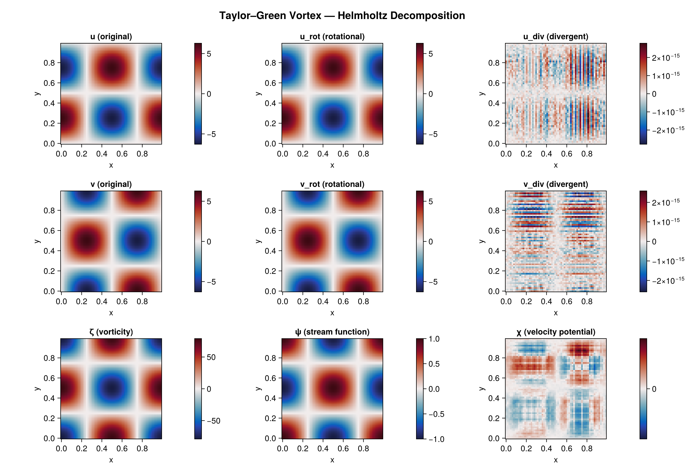
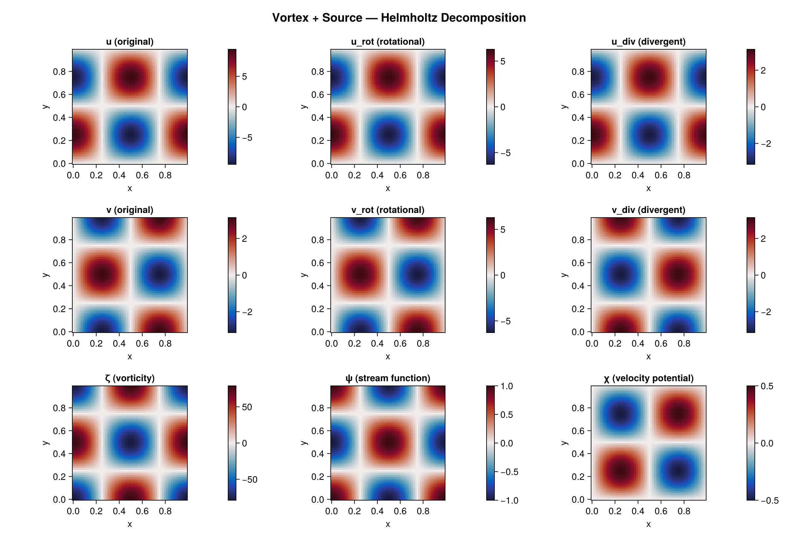
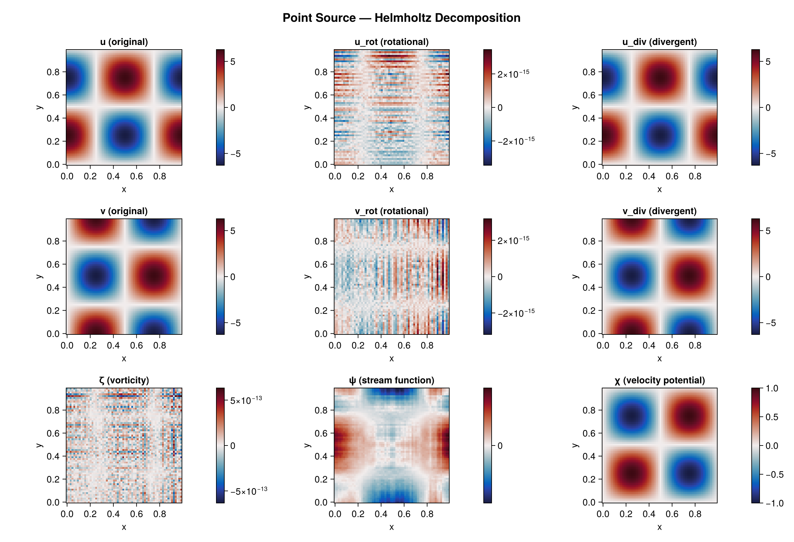
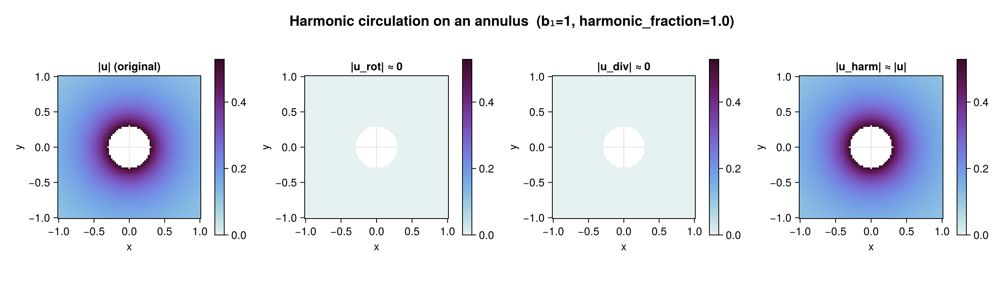
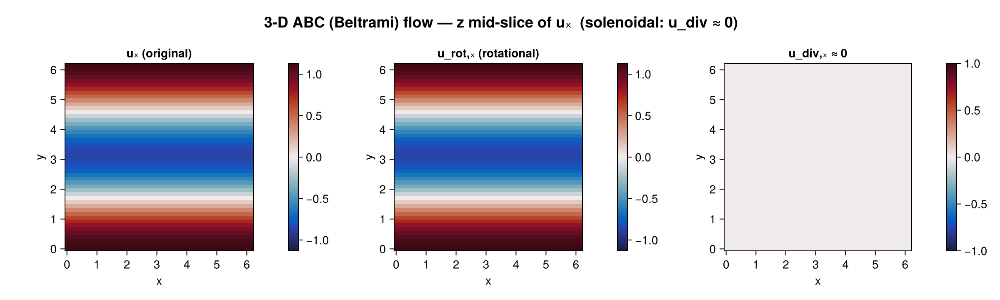
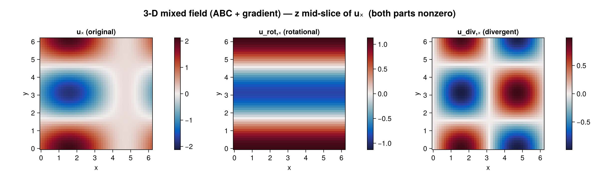
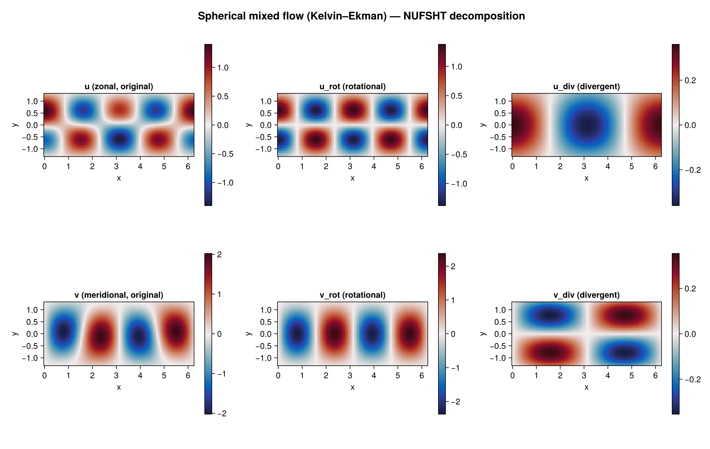

# HelmholtzDecomposition.jl

[](https://jbphyswx.github.io/HelmholtzDecomposition.jl/dev/)
[](https://github.com/jbphyswx/HelmholtzDecomposition.jl/actions/workflows/CI.yml?query=branch%3Amain)
[](https://codecov.io/gh/jbphyswx/HelmholtzDecomposition.jl)

Helmholtz–Hodge decomposition of velocity fields into **rotational** (divergence-free),
**divergent** (curl-free), and **harmonic** components — in **1D/2D/3D and generically N-D**,
on Cartesian and spherical grids. One decomposition runs serially, threaded, or as
KernelAbstractions kernels on a device; a batch of fields runs threaded, on Distributed workers or
on MPI ranks.

```
u  =  u_div (∇χ)  ⊕  u_rot (rot R)  ⊕  u_harm
```

- **u_div** is curl-free, from the scalar velocity potential `χ` (`Δχ = ∇·u`).
- **u_rot** is divergence-free, from the rotation potential `R` (`ΔR_ab = ∂_a u_b − ∂_b u_a`);
  in 2D the single component is the streamfunction `ψ`, in 3D the Hodge dual of the vector
  potential `A`, and in N-D an antisymmetric matrix with `N(N−1)/2` components
  (Glötzl & Richters 2023).
- **u_harm** is the harmonic remainder (both div- and curl-free), nonzero on bounded /
  multiply-connected domains (islands, holes), where it carries the circulation/flux that no
  single-valued potential can represent.

## Why This Package Exists

On the sphere, filtering velocity Cartesian components **does not commute** with differential operators (Aluie 2019, eq. 38). The correct approach — mathematically equivalent to the generalized convolution that **does** commute (Proposition 2) — is to filter the scalar Helmholtz potentials (ψ, χ) separately.

Then for coarse-graining: filter ψ̄, χ̄ as scalars → reconstruct velocity from filtered potentials.

### Taylor-Green Vortex (purely rotational → divergent component ≈ 0)



### Vortex + Source (mixed rotational and divergent)



### Point Source (purely divergent → rotational component ≈ 0)



### Harmonic circulation on an annulus (multiply-connected domain)

A pure circulation around a masked hole is **harmonic** and lands in `u_harm` (`count_holes = 1`).
The part of it that crosses the square box's edge is divergent under the natural boundary condition
`∂χ/∂n = u·n̂`.



### 3-D ABC (Beltrami) flow (`z` mid-slice)

A fully solenoidal 3-D field: the rotational part recovers the original and the divergent
part vanishes.



### 3-D mixed field (`z` mid-slice)

A 3-D field with **both** components (solenoidal ABC + a gradient): the decomposition
splits `uₓ` into a nonzero rotational and a nonzero divergent part.



### Spherical mixed flow (Kelvin–Ekman, NUFSHT)

Decomposition on a longitude–latitude grid via the non-uniform spherical-harmonic
transform: a rotational core plus a smaller divergent (Ekman-like) part.



## Solver extensions

The base package solves any grid, mask and boundary condition with multigrid-preconditioned
conjugate gradients. Where a transform applies it is `O(N log N)`, and its solver runs once the
library is loaded:

| Geometry | Regular grid | Irregular grid |
|----------|-------------|----------------|
| **Cartesian** | an FFT library for the array: `using FFTW` on the host, CUDA's CUFFT for a `CuArray` (periodic, bounded, channel) | `using NonuniformFFTs` or `using FINUFFT` |
| **Spherical** | `using FastSphericalHarmonics` (Clenshaw–Curtis) | `using NUFSHT` (any covering node set) |

`AutoSolver()` (the default) takes the first of those solvers, in the order of the table below, whose
library is loaded and whose requirements the grid and the execution backend meet — mask, axis
uniformity, topology, node layout, and whether the solver's state can live where the backend runs.

**Build axes from ranges.** FlowGeometries proves uniformity from the axis *type*, so a
`collect`ed range is a `Vector`, carries no such proof, and quietly costs every transform fast
path.

## Quick Start

```julia
using HelmholtzDecomposition: HelmholtzDecomposition as HD
using FlowGeometries: FlowGeometries as FG
using FFTW: FFTW  # load a spectral extension

xs = range(0.0, 99_000.0; length = 100)      # a range: uniformity provable from the type
grid = FG.Grids.StructuredGrid(FG.Geometry.CartesianGeometry{Float64}(), xs, xs)

# Physical-space decomposition (mask- and boundary-aware; a transform where one applies)
result = HD.helmholtz_decompose(u, v, grid)

# Or, on a periodic grid (`topology = (true, true)`), the fully spectral path
result = HD.helmholtz_decompose_spectral(u, v, grid)

# Velocity-like fields use a component-last layout (dims..., N):
result.u_rot          # rotational (divergence-free) velocity, (Nx, Ny, 2)
result.u_div          # divergent (curl-free) velocity
result.u_harm         # harmonic remainder
result.χ              # scalar velocity potential
HD.streamfunction(result)   # ψ (2D); HD.vector_potential(result) in 3D, u_rot = ∇ × A
result.harmonic_fraction    # ‖u_harm‖ / ‖u‖ on faces: the share in the harmonic subspace
result.residual_fraction    # the share of u the staggered representation does not carry
```

Under `Neumann` (the default) the split is the natural Helmholtz–Hodge decomposition: the
divergent part carries the normal velocity through every bounded edge (`∂χ/∂n = u·n̂`), and the
rotational and harmonic parts carry none. Every route returns a `HelmholtzResult`; a solve or fit
that stops short of its tolerance is returned with `converged == false` in `χ_solve`/`rot_solve`.

### N-dimensional, devices, and batch

```julia
using ComputationalBackends: ComputationalBackends as CB

# 3-D: pass a single component-last array (Nx, Ny, Nz, 3)
res3 = HD.helmholtz_decompose_spectral(U3, grid3)
A1, A2, A3 = HD.vector_potential(res3)

# A device: plan with a GPUBackend over a KernelAbstractions backend (`using KernelAbstractions`
# and the vendor package); the loops run as kernels and the arrays stay on the device.
gpu = CB.GPUBackend(CUDA.CUDABackend())
plan = HD.plan_helmholtz(grid; execution = gpu)
res = HD.helmholtz_decompose!(HD.allocate_result(plan), CUDA.CuArray(U), plan)

# The periodic spectral route on the device: `U` moves there and the parts come back there.
res = HD.helmholtz_decompose_spectral(U, periodic_grid; execution = gpu)

# Many snapshots on one grid (`using OhMyThreads`, `Distributed` or `MPI` for the parallel axes)
plan = HD.plan_helmholtz(grid)
batch = HD.helmholtz_decompose_batch(plan, fields; execution = CB.ThreadedBackend())
```

`AutoBackend()`, the default, threads a loop when it gives each of Julia's threads at least 16384 of
its indices and runs it serially otherwise, so the coarse levels of a multigrid cycle stay on one
thread; it does not read the array type, so a device array needs its `GPUBackend` named. On a device
`AutoSolver` takes the FFT solvers where an FFT library implements the device's arrays and
multigrid-preconditioned conjugate gradients otherwise. NUFSHT runs on the device it is given, as
`helmholtz_decompose_spectral`'s route on any covering sphere and as a named preconditioner, where a
NUFFT library takes the device's arrays; FastSphericalHarmonics, FFTW's real-to-real transforms and the
scattered fit hold host state and run on host backends. The device path is checked
against the host on `KernelAbstractions.CPU()` and on JLArrays in the test suite; `gpu/runtests.jl`
runs the staggered decomposition and the periodic spectral route on CUDA hardware.

### Scattered / unstructured data

For data sampled at arbitrary point locations (observation networks, floats, tracks), build an
`UnstructuredGrid`. It routes through the non-uniform transforms: a least-squares fit of the Fourier
coefficients (conjugate gradients on the normal equations) → exact Leray projection → synthesis
back to the points. The NUFFTs are [FlowTransformBindings](https://github.com/jbphyswx/FlowTransformBindings.jl)
plans over NonuniformFFTs or FINUFFT.

```julia
using NonuniformFFTs: NonuniformFFTs
using FlowTransformBindings: FlowTransformBindings as FTB
# One coordinate vector per direction, plus a control volume per node.
pts = FG.Grids.UnstructuredGrid(FG.Geometry.CartesianGeometry{Float64}(), (x, y), areas;
                                periodic = (true, true), period = (Lx, Ly))
res = HD.helmholtz_decompose_spectral(U, pts)   # U is (M, 2); parts, χ, ψ and ∇·u at the points

# Or name the library and the mode count:
solver = HD.CartesianNUFFTSolver(FTB.NonuniformFFTsBackend(); nk = (32, 32))
res = HD.helmholtz_decompose_spectral(U, pts; solver)

# A time series on one point set plans its transforms once; `close!` releases them.
state = HD.prepare_solver(solver, pts, FG.Operators.Neumann())
results = [HD.helmholtz_decompose_spectral(U, pts; solver, state) for U in snapshots]
HD.close!(state)
```

On the sphere the same entry point takes **any node set covering `S²`**, through NUFSHT's
spin-weighted transforms: the tangent velocity `V = u_θ + i u_φ` is a spin-1 field, and the
symmetric and antisymmetric parts of its spin(±1) coefficients are its rotational and divergent
components — an exact Hodge split with no finite-difference stencil.

Because it asks only for node positions, one implementation covers every spherical layout
FlowGeometries builds: lat–lon and the spectral quadrature grids, `UnstructuredGrid` point clouds,
and the pixelizations (`HEALPixGrid`, `RingGrid`, `CubedSphereGrid`, `IcosahedralGrid`,
`YinYangGrid`).

```julia
using NUFSHT: NUFSHT
sph  = FG.Geometry.SphericalGeometry(1.0)
grid = FG.Grids.StructuredGrid(sph, lons, lats; topology = (true, false), period = (2π, 0.0))
res  = HD.helmholtz_decompose_spectral(U, grid)   # U is (nlon, nlat, 2) = (u_east, u_north)
```

The expansion degree is sized from the grid unless `lmax` is given, and a fit that does not
converge is returned flagged.

### Multiply-connected domains (the harmonic part)

```julia
# An island: any Bool array of the grid's shape, false where a cell is out of the domain.
mask = [ (x - 0.5)^2 + (y - 0.5)^2 > 0.09 for x in xs, y in ys ]
grid = FG.Grids.StructuredGrid(FG.Geometry.CartesianGeometry{Float64}(), xs, ys; mask = mask)
HD.count_holes(grid)                                  # 1  (b₁ of the active region)
res = HD.helmholtz_decompose(u, v, grid)
res.harmonic_fraction                                 # ≈ 1 for a pure circulation about the hole
```

## Mathematical Formulation

The Helmholtz decomposition expresses any 2D vector field as:

**u** = **u**_rot + **u**_div

where:
- **u**_rot = ∇ × (ψ ẑ) is non-divergent (∇ · **u**_rot = 0)
- **u**_div = ∇χ is irrotational (∇ × **u**_div = 0)

The scalar potentials are found by solving:
- ∇²ψ = ζ (vorticity = ∂v/∂x − ∂u/∂y)
- ∇²χ = δ (divergence = ∂u/∂x + ∂v/∂y)

On the sphere (radius R):
- ∇²ψ = ζ → eigenvalue −ℓ(ℓ+1)/R²
- u_rot = −(1/R) ∂ψ/∂φ, v_rot = 1/(R cos φ) ∂ψ/∂λ

## When is Helmholtz Required?

- **Not needed:** non-divergent velocity, e.g. SSH-derived geostrophic flow — Storer et al. (2022)
- **Required:** full model velocity with both rotational and divergent components
- **Also needed:** separating the energy flux Π into toroidal and potential contributions —
  Buzzicotti et al. (2023)

## Two backend axes

The package keeps two orthogonal axes separate:

**Spectral / Poisson solver** (the math), selected by `AutoSolver()` or passed explicitly:

| Solver | When to use |
|--------|-------------|
| `HD.CGSolver()` (base, dimension-generic) | any grid: masked domains, any boundary condition, any geometry. Multigrid-preconditioned by default |
| `HD.CartesianSpectralSolver()` (AbstractFFTs: FFTW, CUFFT) | uniform periodic Cartesian, any dimension, host or device |
| `HD.CartesianBoundedSolver()` (FFTW) | uniform Cartesian with any mix of bounded and periodic directions, including a channel, on the host |
| `HD.CartesianRealTransformSolver()` (AbstractFFTs: FFTW, CUFFT) | the same, through whichever FFT library implements the array, host or device |
| `HD.CartesianNUFFTSolver(nufft; nk)` (NonuniformFFTs or FINUFFT) | scattered Cartesian, any dimension |
| `HD.SphericalSpectralSolver()` (FastSphericalHarmonics) | Clenshaw–Curtis lat/lon (`Nlon = 2·Nlat−1`) |
| `HD.SphericalNUSHTSolver()` (NUFSHT) | any spherical node set covering `S²` |

The spherical transforms invert the continuous Laplacian. `helmholtz_decompose_spectral` uses them
directly; on the staggered path (`helmholtz_decompose`, `plan_helmholtz`) they precondition
`CGSolver` on the grid's own discrete Laplacian, named or chosen by `AutoSolver`, so the divergent
part carries the field's divergence on the grid to the solver tolerance.

`AutoSolver` is mask-aware (never picks a transform on a masked domain) and backend-aware (never picks
a solver whose state lives on the host for a device backend), and takes a Cartesian transform where
one applies, a spherical preconditioner on a sphere whose nodes one accepts, and multigrid otherwise.

**Execution backend** (where the loops of one decomposition run): `SerialBackend`,
`ThreadedBackend`, `GPUBackend(backend)` over a KernelAbstractions backend, passed as `execution=` to
`plan_helmholtz` / `helmholtz_decompose` / `helmholtz_decompose_spectral`. **Batch backend** (how
fields are spread): `SerialBackend`, `ThreadedBackend` (`using OhMyThreads`), `DistributedBackend`
(`using Distributed`), `MPIBackend` (`using MPI`), passed as `execution=` to
`helmholtz_decompose_batch`. Under a serial batch each field's loops run on the plan's backend; on a
host plan a threaded batch runs each field serially and a Distributed or MPI batch on its inner
backend, and on a device plan every field runs on the device. `AutoBackend()` threads a loop only
when it is long enough to give every thread 16384 indices.

## Relationship to Structure Function "Helmholtz Decomposition"

This package performs **spatial** Helmholtz decomposition (Poisson solver). This is distinct from:
- **Lindborg (2015) integral relations** used in `StructureFunctions.jl` for decomposing D_LL, D_TT → D_rot, D_div via cumulative integrals (no Poisson solver needed).

These are two completely different operations that happen to share the name "Helmholtz decomposition."

## References

- **Aluie (2019)**: doi:10.1007/s13137-019-0123-9 — Convolutions on the sphere; Proposition 2 proves Helmholtz filtering commutes with ∇
- **Buzzicotti, Storer, Khatri, Griffies, Aluie (2023)**: doi:10.1126/sciadv.adi7420 — Global kinetic energy cascade using Helmholtz filtering
- **Storer et al. (2022)**: doi:10.1038/s41467-022-33031-3 — When Helmholtz is not needed (non-divergent fields)
- **Lindborg (2015)**: doi:10.1017/jfm.2014.685 — SF integral relations (different "Helmholtz")
- **Berlinghieri et al. (2023)**: doi:10.1029/2022GL097713 — GP Helmholtz for ocean currents

## See Also

- [ImmersedLayers.jl](https://juliaibpm.github.io/ImmersedLayers.jl/stable/manual/helmholtz/) — Alternative Helmholtz implementation using lattice Green's functions
- [FlowSieve](https://flowsieve.readthedocs.io/) — C++ coarse-graining toolkit with Helmholtz mode
